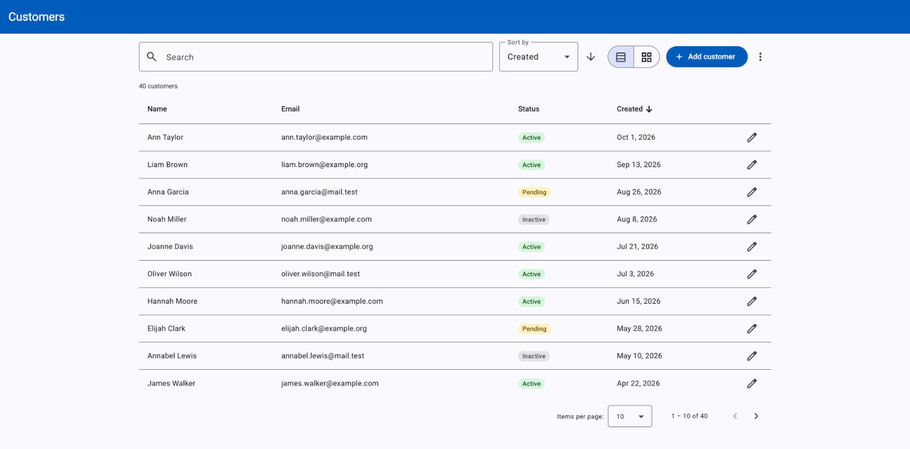
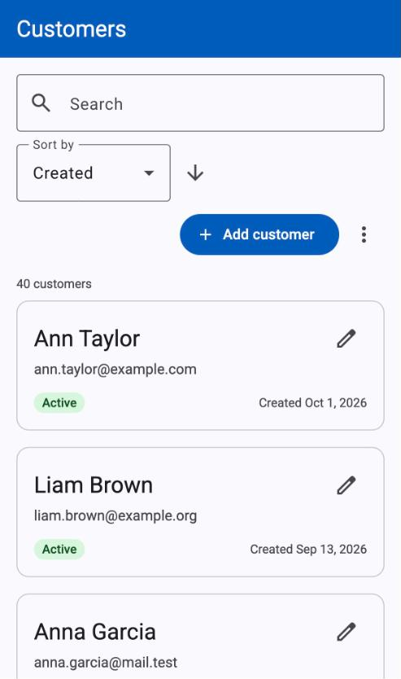

# Customer Management App

A small app for managing customers: list, search, sort, add, edit, and reset the demo data.
The client is **Angular 22 with Angular Material**. It talks to a small **Express 5 + TypeScript** API that keeps
customers in memory. Built as a home assignment for an Angular Front-End Developer role.

It was built in nine small phases, each with its own task list and acceptance criteria ([docs/PLAN.md](docs/PLAN.md)).

<p>
  
  &nbsp;
  
</p>

## Prerequisites

- **Node 24** (pinned in [`.nvmrc`](.nvmrc)). Angular 22 needs Node ≥ 22.22 or ≥ 24.15, so it won't run on Node 20.
- npm (comes with Node).

With [nvm](https://github.com/nvm-sh/nvm):

```bash
nvm install   # once: installs the version from .nvmrc
nvm use       # in every new terminal, from the repo root
```

## Getting started

```bash
nvm use
npm run install:all   # installs root, server and client dependencies
npm run dev           # starts the API and the Angular dev server together
```

| What | URL |
|---|---|
| App | http://localhost:4200 |
| API | http://localhost:3000/api/customers |

The client calls `/api/...` on its own origin. The Angular dev server forwards those calls to the API
([`client/proxy.conf.json`](client/proxy.conf.json)), so no CORS setup is needed.

## Scripts

Run from the repo root:

| Command | Does |
|---|---|
| `npm run install:all` | Installs dependencies for root, `server/` and `client/` |
| `npm run dev` | Runs the API (port 3000) and the client (port 4200) together, with labelled output |
| `npm run test` | Runs the server tests (Node's built-in test runner), then the client tests (Vitest), once each |
| `npm --prefix server run typecheck` | Type-checks the server |
| `npm --prefix client run build` | Production build of the client into `client/dist/` |

## Data and API

- The server starts with **40 seeded customers**, held in memory. Restarting the server, or calling
  `POST /api/customers/reset`, restores the original data.
- Search, sort and paging run on the server (`GET /api/customers?q=ann&sort=name&order=asc&page=1&pageSize=10`).
  The response is one page: `{ items, total, page, pageSize }`.
- The full contract (endpoints, validation, error shape) is in [docs/API.md](docs/API.md).
  [`server/requests.http`](server/requests.http) has a ready-made request for each endpoint (VS Code REST Client extension).

**Dev knobs.** These environment variables make loading and error states easy to see:

| Variable | Default | Effect |
|---|---|---|
| `API_DELAY_MS` | `400` | Adds delay to every API response |
| `API_FAIL_RATE` | `0` | Chance (0–1) that a request fails with a `500` |
| `SEED` | demo data | `SEED=empty` starts with no customers, to see the empty state. Reset keeps it empty |
| `API_PORT` | `3000` | API port. The client proxy expects 3000 |

```bash
API_FAIL_RATE=0.3 npm run dev     # roughly 1 in 3 requests fails
API_DELAY_MS=1500 npm run dev     # slow responses, to see loading states and cancelled searches
SEED=empty npm run dev            # no customers, to see the "No customers yet" state
```

These examples use macOS / Linux shell syntax. On Windows, run them in Git Bash or WSL.

## Architecture and technical choices

The short version. Every choice, with its reason, is in [docs/DECISIONS.md](docs/DECISIONS.md).

- **Feature folders.** Everything about customers is in `features/customers/`. `shared/ui/` only holds parts that
  know nothing about customers (dialog, toast, page states).
- **Smart page, simple components.** Only `CustomersPage` and the add/edit dialog talk to the store. The toolbar,
  table, cards and state components only take inputs and send outputs, so they're easy to reuse and test.
- **One store service built on signals, no NgRx.** One feature with one kind of data doesn't need a state
  library. The store exposes read-only signals and methods like `setQuery()`, `setSort()`, `create()`, `reset()`.
  RxJS is used only where streams help: the search pipeline and HTTP.
- **Data is there when the app starts.** `provideAppInitializer` waits for the first list. `load()` never
  rejects: an error goes into the store's `error` signal, so a failing API shows an error with "Try again"
  instead of a blank page.
- **Search, sort and paging run on the server.** The API returns one page at a time, so the client couldn't
  search or sort the other pages anyway.
- **The add/edit dialog saves through the store itself**, so it can stay open and show a server error (like
  "A customer with this email already exists") next to the right field.
- **Our own dialog and toast design.** Dialogs are built on the Angular CDK `Dialog`, which handles focus,
  Escape and screen-reader roles. Messages go through a small `NotificationService`. Spacing, radius and status
  colours live in one file, `client/src/_tokens.scss`. Colours and type come from the Material theme.
- **Errors are planned, not patched.** [docs/ERROR-HANDLING.md](docs/ERROR-HANDLING.md) lists every error case,
  what the user sees, and which part of the app handles it.
- **Angular 22 defaults kept:** no zone.js (zoneless), Vitest for tests, strict TypeScript. The dev proxy
  forwards `/api` to the server, so there's no CORS setup.

**Search.** The assignment asks for search that feels responsive and doesn't overload the API. In the store:

1. The text is trimmed, then `debounceTime(300)` waits until typing pauses for 300ms.
2. If the text is the same as the last request's, it's skipped. Sort and page clicks don't wait, since they're
   single clicks.
3. `switchMap` sends the request and cancels the previous one if it's still running, so an old, slow answer can
   never replace a newer one.
4. `catchError` sits **inside** the `switchMap`. If it were outside, the first failed request would end the
   stream and search would stop working.
5. While a search runs, the current results stay on screen with a thin progress bar instead of a spinner.
6. If a search finds no one, longer text that contains it (for example "zz" → "zzz") is skipped without
   calling the API, because it can only match fewer customers.

Filtering in the browser would have been a fair choice while the API returned every customer. Once the list
was paged, the client only holds one page, so searching on the server is the only correct option.

## Tests

`npm run test` runs both suites once. No testing libraries were added.

- **Server (34 tests, Node's built-in `node:test`):** query parsing, validation rules, and the store's search,
  sort, paging and reset.
- **Client (59 tests, Vitest from the Angular CLI):** the store's search pipeline (with fake timers and
  controlled responses), the API service's error mapping, the add/edit dialog's server errors, the confirm dialog,
  notifications, the toolbar, and the page's states.

## Project structure

```
├── package.json            root scripts only (no workspaces)
├── docs/                   plan, API contract, decisions, per-phase specs, screenshots/
├── server/
│   ├── requests.http       manual API checks
│   └── src/                index.ts (app setup), customers.routes.ts, customers.store.ts,
│                           validation.ts, errors.ts, seed.ts; *.test.ts next to what they test
└── client/
    ├── proxy.conf.json     /api → http://localhost:3000
    └── src/
        ├── styles.scss     Material theme (colours, type)
        ├── _tokens.scss    the app's own design values: spacing, radius, status colours
        └── app/
            ├── app.ts, app.config.ts, app.routes.ts
            ├── features/customers/
            │   ├── data/             customer.model.ts, customer-api.service.ts, customer.store.ts
            │   ├── customers-page/   the smart page: connects the store to the components and dialogs
            │   └── components/       customer-toolbar/, customer-table/, customer-cards/,
            │                         customer-status-badge/ (inputs in, outputs out),
            │                         customer-form-dialog/ (add/edit; saves through the store)
            └── shared/ui/            no customer knowledge, inputs in, outputs out
                ├── dialog-shell/     the look of every dialog + AppDialog, which opens them (CDK Dialog)
                ├── confirm-dialog/   generic yes/no dialog
                ├── notification/     NotificationService + the toast that shows its messages
                ├── error-banner/     red inline error box (list banner, dialog error)
                └── loading-state/, error-state/, empty-state/   full-area page states
```

## Documentation

| File | What's in it |
|---|---|
| [docs/PLAN.md](docs/PLAN.md) | Phases, progress, and where each assignment requirement is handled |
| [docs/API.md](docs/API.md) | The API contract between client and server |
| [docs/ERROR-HANDLING.md](docs/ERROR-HANDLING.md) | What the user sees for every kind of error, and which part of the app handles it |
| [docs/DECISIONS.md](docs/DECISIONS.md) | Technical choices and why, plus a log of AI suggestions that were changed or rejected |
| [docs/phases/](docs/phases/) | Task list and acceptance criteria for each phase |
| [CLAUDE.md](CLAUDE.md) | Conventions and workflow rules for working on this repo (also read by Claude Code) |

## AI usage

I used **Claude chat** for getting the general idea of what I want to develop (Whether I should create a small server, angular versions, clarifying angular updates since I was used to work with angular 18) and
**Claude Code** to write the code, tests and docs, one phase at a time.

How I kept control of it:

- [CLAUDE.md](CLAUDE.md) sets the rules: the stack, Angular conventions, what not to add, and which docs to update
  with each change.
- Each phase in [docs/phases/](docs/phases/) has acceptance criteria. Claude Code stopped after every phase, and
  I reviewed the changes and each commit before moving on.
- When I changed or rejected a suggestion, it was logged in [docs/DECISIONS.md](docs/DECISIONS.md#ai-suggestions-changed-or-rejected).

Suggestions I changed or rejected:

- **Clickable table rows.** It suggested only an edit button. I wanted clickable rows, built them, and then
  removed them: a row click only opened the same dialog as the button.
- **Startup spinner.** It suggested not waiting for the first list, so the page could show its own spinner. I
  kept the wait (customers are on screen at first render) and asked for a simple spinner in `index.html` instead.
- **Search on the server.** I asked why search and sort call the API when the first call already returned
  everyone. It suggested keeping them on the server and writing up the trade-off. I chose to add pagination,
  which makes server-side search the only correct option.
- **The search ✕ with only spaces.** It suggested leaving it. I had it fixed, so the ✕ only shows for real text.

## Known limitations

- Data lives in memory: restarting the server brings back the seed data.
- The `Customer` type is written twice, once in the client and once in the server.
- No auth. Anyone who can reach the API can call the reset endpoint (the UI asks for confirmation first).
- Search, sort and page aren't in the URL, so a reload or a shared link starts from the default list.
- No delete.
- The HTTP routes are checked by hand with [`server/requests.http`](server/requests.http). The automated server
  tests cover the logic behind them, not the routes.
- A search that found no one is remembered. If a matching customer is added in another tab, longer searches
  won't show them until a reload or a shorter search.
- Skipped stretch items from the plan: a compact list view and URL-synced filters.

## With more time

- Keep search, sort and page in the URL.
- Delete a customer.
- Real storage (SQLite or Postgres) instead of memory.
- One shared types package for the client and the server.
- End-to-end tests (Playwright) and route tests for the API.
- Optimistic updates, so a save shows at once instead of after the reload.
- Virtual scrolling for very long pages.
- Signal Forms for the add/edit form, now that they're stable in Angular 22.
